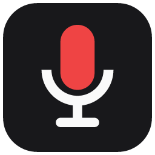

<h1 align="center">Dikte</h1>

Tuşa bas, konuş, bırak: söylediklerin o an yazdığın yere düşer. 
Kendi OpenAI API anahtarınla çalışan, Windows 11 için küçük ve açık kaynak bir sesle yazma aracı.

---

Dikte, araçlarıyla konuşanlar için: terminaldeki Claude Code, bir sohbet kutusu, bir e-posta, bir commit mesajı.
Bildirim alanında durur, yalnızca kısayolu basılı tuttuğun sürece dinler, kaydı bir konuşmadan yazıya modeline gönderir
ve sonucu öndeki pencereye yapıştırır. `gpt-transcribe` ile bir saatlik konuşma yaklaşık **0,27 $**.

## Kullanım

1. [Son sürümden](../../releases/latest/download/Dikte.exe) `Dikte.exe`'yi indirip çalıştır. İmzalı olmadığı için
   SmartScreen sorabilir: **Ek bilgi → Yine de çalıştır**.
2. İstediğinde API anahtarını yapıştır. Denenir, sonra Windows kullanıcına özel şifrelenerek saklanır.
3. Bir metin alanına tıkla, **`Ctrl + Win`'i basılı tut**, konuş, bırak.

| Ne yaparsan | Ne olur |
|---|---|
| `Ctrl + Win` basılı | Basılı tuttukça dinler, bırakınca yapıştırır |
| Basılıyken `Space` | Eller serbest: konuşmaya devam et, tekrar `Ctrl + Win` gönderir |
| `Esc` | Kaydı ya da yoldaki yazıyı iptal eder |
| Tepsi simgesine sol tık | Eller serbest dikteyi fareyle başlatır/bitirir |

Türkçe ve İngilizceyi cümle içinde karıştırabilirsin; `language` boş kalsın. Ayarlar, gizlilik ve derleme için
[İngilizce README](README.md).

## Lisans

MIT © 2026 Bayram Akan
